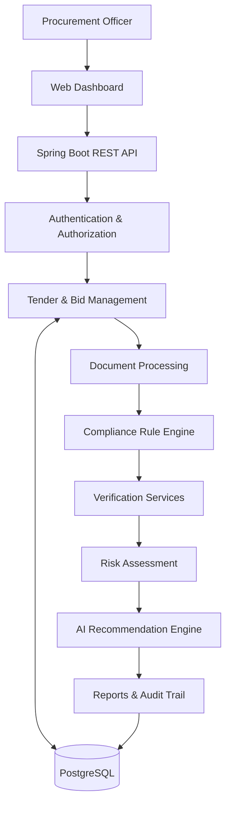

# 🏛️ AI-Powered Bid Compliance Verification Platform

### Intelligent, Transparent & Automated Government Procurement Verification


> An AI-assisted procurement compliance platform designed to help government officers verify bidder eligibility, detect discrepancies, assess compliance risks, and generate evidence-backed recommendations.

---

## 📌 Overview

Government procurement through the **Government e-Marketplace (GeM)** requires procurement officers to verify numerous statutory, regulatory, and tender-specific requirements before evaluating suppliers.

This process often involves manually reviewing documents, cross-checking government records, identifying inconsistencies, and ensuring compliance with procurement policies.

The **AI-Powered Bid Compliance Verification Platform** aims to simplify this process through automated document analysis, configurable compliance rules, risk assessment, and transparent reporting.

The platform acts as a **decision-support system**, assisting procurement officers rather than replacing their final judgment.

---

## 🎯 Problem Statement

Traditional bid compliance verification faces several challenges:

- **Manual Verification:** Officers must inspect large volumes of documents.
- **Fragmented Information:** Verification requires checking multiple government portals and databases.
- **Human Errors:** Manual evaluation increases the possibility of missed discrepancies.
- **Time-Consuming Evaluation:** Compliance verification can delay procurement decisions.
- **Limited Transparency:** Maintaining consistent evidence and audit records can be difficult.
- **Complex Requirements:** Every tender may have different eligibility conditions.

### Our Solution

A centralized platform that automates preliminary compliance checks, highlights potential violations, calculates risk indicators, and provides explainable recommendations supported by verification evidence.

---

## ✨ Key Features

### 📄 1. AI-Powered Document Processing
- Upload and manage bidder documents.
- Extract relevant information from PDFs and scanned documents using OCR.
- Identify registration numbers, dates, financial figures, and certification details.
- Flag missing, inconsistent, or potentially invalid information.

### ✅ 2. Tender-Specific Compliance Verification
- Define mandatory and optional requirements for individual tenders.
- Validate bidder information against configurable eligibility rules.
- Support rule-based checks for turnover, registrations, certifications, and statutory compliance.
- Distinguish compliant, non-compliant, and unverifiable requirements.

### 🔍 3. Discrepancy Detection
- Compare submitted information with trusted verification evidence.
- Detect mismatched registration details, missing documents, and conflicting financial information.
- Highlight expired or unverifiable certifications.
- Present discrepancies alongside supporting evidence.

### 📊 4. Risk Assessment
- Calculate configurable compliance risk scores.
- Consider the severity of detected discrepancies.
- Highlight bids requiring additional investigation.
- Explain the factors contributing to each risk score.

### 🧠 5. AI-Assisted Recommendations
- Generate understandable summaries of verification findings.
- Explain potential compliance concerns.
- Recommend whether a bid should proceed, require clarification, or undergo further review.
- Keep final acceptance or rejection decisions under authorized human control.

### 🔐 6. Role-Based Access Control
- Secure authentication and authorization using Spring Security.
- Separate permissions for administrators and procurement officers.
- Restrict access to sensitive bidder information.
- Maintain accountability for verification and review actions.

### 📝 7. Audit Trails & Reporting
- Record verification activities and officer decisions.
- Maintain traceable evidence for compliance findings.
- Generate structured bidder evaluation reports.
- Support tamper-evident audit records.

---

## 🏗️ System Architecture

The proposed system follows a modular backend architecture with clearly separated responsibilities.



### Core Components

| Component | Responsibility |
|-----------|----------------|
| Tender Management | Define tenders and their eligibility requirements |
| Bid Management | Manage bidders, submissions, and uploaded documents |
| Document Processing | Extract and structure document information |
| Compliance Engine | Execute tender-specific verification rules |
| Verification Services | Cross-check information against permitted trusted sources |
| Risk Engine | Calculate compliance risk indicators |
| AI Engine | Generate explanations and recommendations |
| Audit Module | Record evidence, actions, and verification outcomes |

---

## ⚙️ Technology Stack

| Layer | Technology |
|-------|------------|
| Backend | Java 21, Spring Boot |
| Security | Spring Security, JWT |
| Database | PostgreSQL |
| ORM | Spring Data JPA, Hibernate |
| Batch Processing | Spring Batch |
| Messaging | Apache Kafka |
| Compliance Logic | Configurable Rule Engine |
| AI Integration | LLM API / AI Service |
| Document Processing | PDF Parsing, OCR |
| API Documentation | OpenAPI / Swagger |
| Testing | JUnit, Mockito, Testcontainers |
| Deployment | Docker, Docker Compose |

> The technology stack represents the proposed implementation and may evolve during development.

---

## 🔄 How the Platform Works

### Step 1: Tender Creation
A procurement officer creates a tender and configures its eligibility requirements.

**Example: Government Laptop Procurement**

- Minimum annual turnover: ₹5 crore
- Valid GST registration
- Valid PAN details
- Required OEM authorization
- No applicable debarment restrictions

### Step 2: Bid Submission
Bidders submit their proposals and supporting documents.

A **bidder** is a supplier, company, or eligible business participating in a government tender.

### Step 3: Document Analysis
The system processes uploaded documents and extracts information such as:

- Company name and registration identifiers
- GST and PAN details
- Annual turnover
- Certificate validity dates
- OEM authorization details

### Step 4: Compliance Verification
The platform evaluates each bidder against the requirements of the selected tender.

Where authorized verification integrations are available, the system cross-checks submitted information against trusted sources.

### Step 5: Discrepancy Detection
The system identifies potential inconsistencies.

**Example:**

| Requirement | Bidder Submission | Verification Finding |
|-------------|-------------------|----------------------|
| GST Registration | Active | Verified |
| Annual Turnover | ₹8 crore | ₹4 crore in verified evidence |
| PAN Details | Submitted | Matched |
| OEM Authorization | Uploaded | Unable to verify |

The turnover mismatch is flagged for review, while the OEM authorization remains unverified.

### Step 6: Risk Assessment
The platform calculates a risk indicator using factors such as:

- Mandatory requirement violations
- Severity of detected discrepancies
- Missing or unverified evidence
- Document inconsistencies

### Step 7: Recommendation & Review
The platform produces an evidence-backed compliance report.

The procurement officer examines the findings and makes the final decision according to applicable procurement rules.

---

## 📋 Example Verification Report

**Tender:** Government Laptop Procurement  
**Bidder:** ABC Technologies Pvt. Ltd.

| Verification Check | Result |
|--------------------|--------|
| GST Registration | ✅ Verified |
| PAN Verification | ✅ Verified |
| Turnover Requirement | ❌ Not Satisfied |
| OEM Authorization | ⚠️ Requires Review |
| Debarment Check | ⚠️ Pending Verification |

**Illustrative Risk Score:** 72/100 — High Risk

**System Recommendation:** Manual Review Required

**Explanation:** The verified turnover is below the tender's minimum requirement. OEM authorization also requires further validation.

> Risk scores are configurable indicators, not definitive findings of fraud or automatic grounds for disqualification.

---

## 🔒 Security & Transparency

The platform is designed with security and accountability as core principles.

- **Authentication:** JWT-based secure access.
- **Authorization:** Role-based permission enforcement.
- **Data Protection:** Secure storage and controlled access to sensitive documents.
- **Audit Logging:** Traceability of verification and decision-making.
- **Evidence Tracking:** Linking compliance findings to supporting records.
- **Human Oversight:** Authorized officers retain final decision-making authority.

---

## 🚀 Development Roadmap

The platform is planned to be developed in multiple phases.

### Phase 1 — Backend Foundation
- [ ] Initialize Spring Boot project
- [ ] Configure PostgreSQL and Spring Data JPA
- [ ] Implement authentication and role-based authorization
- [ ] Develop tender and bidder management APIs
- [ ] Implement document upload and storage

### Phase 2 — Compliance Verification
- [ ] Design configurable tender eligibility rules
- [ ] Implement the rule evaluation engine
- [ ] Add document extraction and validation
- [ ] Build discrepancy detection workflows
- [ ] Integrate available authorized verification sources

### Phase 3 — AI & Risk Analysis
- [ ] Implement configurable risk scoring
- [ ] Integrate AI-assisted document analysis
- [ ] Generate explainable compliance recommendations
- [ ] Build evidence-backed verification reports

### Phase 4 — Enterprise Capabilities
- [ ] Implement Spring Batch for bulk bid evaluation
- [ ] Integrate Kafka for asynchronous processing
- [ ] Develop tamper-evident audit logging
- [ ] Add monitoring and performance metrics
- [ ] Containerize and deploy the application

---

## 💻 Getting Started

> Setup instructions will be finalized as the backend implementation progresses.

### Prerequisites

Install the following tools:

- Java 21
- PostgreSQL
- Docker and Docker Compose
- Git
- IntelliJ IDEA or another Java IDE

Maven Wrapper will be used for project builds.

### Clone the Repository

```bash
git clone <repository-url>
cd <repository-directory>
```

### Configure the Application

Configure database credentials and other environment-specific settings using environment variables or local configuration files.

Sensitive credentials and API keys must not be committed to version control.

### Run the Backend

Once the Spring Boot project is initialized, start the backend using Maven Wrapper.

**Windows:**
```bash
.\mvnw.cmd spring-boot:run
```

**Linux / macOS:**
```bash
./mvnw spring-boot:run
```

### Run Tests

**Windows:**
```bash
.\mvnw.cmd test
```

**Linux / macOS:**
```bash
./mvnw test
```

---

## 📂 Project Structure

The proposed backend organization is:

```text
src/
└── main/
    ├── java/
    │   └── com/
    │       └── bidcompliance/
    │           ├── config/
    │           ├── controller/
    │           ├── service/
    │           ├── repository/
    │           ├── entity/
    │           ├── dto/
    │           ├── security/
    │           ├── compliance/
    │           ├── verification/
    │           ├── risk/
    │           ├── ai/
    │           ├── audit/
    │           └── exception/
    └── resources/
        └── application.yml
```

The structure may be refined as the application evolves.

---

## ⚠️ Important Considerations

- The platform is intended to **assist government procurement officers**, not autonomously award or reject tenders.
- Integration with government portals and databases depends on authorized access and API availability.
- A failed verification does not necessarily indicate fraud.
- AI-generated findings must be supported by verifiable evidence.
- Actual procurement decisions must follow applicable GeM policies, tender terms, and statutory requirements.
- Demonstrations may use synthetic bidder records and simulated verification responses.

---

## 🌱 Future Enhancements

- Integration with additional authorized government verification services.
- Advanced fraud and anomaly detection.
- Cross-document consistency analysis.
- Bulk evaluation of large tender submissions.
- Multi-language document processing.
- Real-time compliance dashboards.
- Configurable approval workflows.
- Advanced procurement analytics.

---

## 🎯 Project Objective

To build a **secure, scalable, and explainable procurement compliance platform** that reduces repetitive manual verification, improves consistency, identifies compliance risks, and supports transparent, evidence-based government procurement decisions.

---

## 📚 References

- [Government e-Marketplace (GeM)](https://gem.gov.in/)
- [Spring Boot Documentation](https://docs.spring.io/spring-boot/)
- [Spring Security Documentation](https://docs.spring.io/spring-security/reference/)
- [PostgreSQL Documentation](https://www.postgresql.org/docs/)
- [Apache Kafka Documentation](https://kafka.apache.org/documentation/)

---

<p align="center">
  <b>AI-Powered Bid Compliance Verification Platform</b>
</p>

<p align="center">
  Making government procurement verification smarter, faster, and more transparent.
</p>
